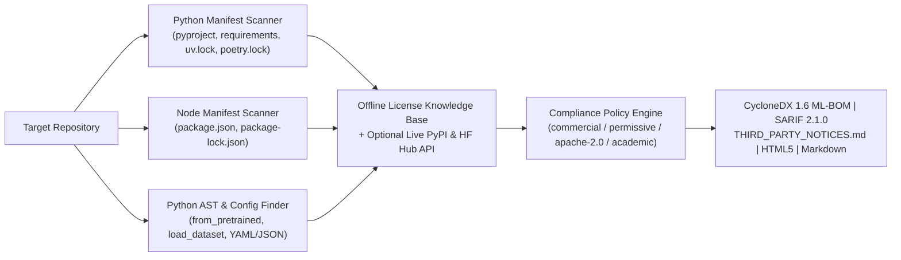

# AI-SBOM-Gate

> **Unified license compliance gate, CycloneDX 1.6 ML-BOM generator, and remediation advisor for code dependencies, Hugging Face models, and datasets.**

[](LICENSE)
[](pyproject.toml)
[-success.svg)](THIRD_PARTY_NOTICES.md)
[](src/ai_sbom_gate/exporters/cyclonedx_mlbom.py)

---

## Why AI-SBOM-Gate?

Traditional Software Composition Analysis (SCA) tools only inspect `requirements.txt` or `package.json`—they are blind to **Hugging Face model cards** and **training/evaluation datasets** referenced inside Python source code.

Meanwhile, AI teams routinely ship repositories marked `MIT` or `Apache-2.0` while accidentally bundling:

| Hidden AI Supply Chain Trap | Real-World Conflict Example | AI-SBOM-Gate Action |
| :--- | :--- | :--- |
| **Network Copyleft (`AGPL-3.0`)** | Pulling `PyMuPDF` (`fitz`) or `ultralytics` into a closed-source SaaS API | Flags `CRITICAL` contagion + recommends `pypdfium2` (`Apache-2.0`) or `onnxruntime` (`MIT`) |
| **Non-Commercial Weights** | Calling `black-forest-labs/FLUX.1-dev` in a commercial product | Flags `CRITICAL` `FLUX-1-dev-Non-Commercial` + recommends `FLUX.1-schnell` (`Apache-2.0`) |
| **Non-Commercial Datasets** | Fine-tuning with `tatsu-lab/alpaca` (`CC-BY-NC-4.0`) or `lmsys/lmsys-chat-1m` | Flags `CRITICAL` NC conflict + recommends `yahma/alpaca-cleaned` / `smoltalk` |
| **Custom AI Clauses & MAU Caps** | Redistributing `Llama-3.1` (`>700M MAU`) or `Gemma` inside pure OSI repos | Surfaces exact attribution, AUP, and threshold obligations |
| **Missing AI-SBOM & Notices** | Enterprise procurement or EU AI Act audits requesting an AI inventory | Exports standard **CycloneDX 1.6 ML-BOM** & **`THIRD_PARTY_NOTICES.md`** in one command |

---

## Architecture



---

## 30-Second Quick Start

`ai-sbom-gate` runs with **zero mandatory third-party dependencies** on Python 3.10+.

```bash
pip install -e .

# 1. Scan a commercial/closed-source AI project (offline + built-in AI license catalog)
ai-sbom-gate scan examples/risky_ai_startup_app --policy commercial-closed-source

# 2. Verify a clean commercial-safe RAG project scores 100 / 100
ai-sbom-gate scan examples/compliant_rag_app --policy commercial-closed-source --fail-on low

# 3. Export CycloneDX 1.6 ML-BOM, THIRD_PARTY_NOTICES.md, SARIF 2.1.0, and HTML dashboard
ai-sbom-gate scan . --exclude examples --policy open-source-permissive \
  --mlbom-out ai-sbom.cdx.json \
  --notices-out THIRD_PARTY_NOTICES.md \
  --format html --output compliance-report.html

# 4. Query live PyPI & Hugging Face Hub APIs for unknown models/datasets
ai-sbom-gate scan /path/to/my-repo --online --policy commercial-closed-source

# 5. Check a single Hugging Face model or package before adding it
ai-sbom-gate check-asset black-forest-labs/FLUX.1-dev --type hf-model --policy commercial-closed-source
```

---

## Supported Compliance Policies

| Policy Flag (`--policy`) | Intended Scenario | Copyleft (`AGPL`/`GPL`) | Non-Commercial (`NC`) | Custom AI Terms (`Llama`/`Gemma`) |
| :--- | :--- | :---: | :---: | :---: |
| `commercial-closed-source` | Proprietary SaaS / commercial product | FAIL (`CRITICAL`/`HIGH`) | FAIL (`CRITICAL`) | WARN (`MEDIUM` review) |
| `open-source-permissive` | MIT / BSD / Apache-2.0 OSS repo | FAIL (`CRITICAL`/`HIGH`) | FAIL (`CRITICAL`) | WARN (`MEDIUM` OSI mismatch) |
| `apache-2.0-strict` | Strict Apache-2.0 redistribution | FAIL (`CRITICAL`/`HIGH`) | FAIL (`CRITICAL`) | WARN (`MEDIUM`) |
| `academic-research` | Non-commercial research / benchmarks | WARN (`LOW` notice) | ALLOW | ALLOW (`MEDIUM` notice) |

---

## GitHub Actions Integration

Drop `ai-sbom-gate` into any repository via `action.yml`:

```yaml
- name: AI-SBOM Compliance Gate
  uses: NPLMSHJTR/ai-sbom-gate@v0.1.0
  with:
    path: "."
    policy: "commercial-closed-source"
    format: "sarif"
    output-file: "ai-sbom.sarif"
    mlbom-output: "ai-sbom.cdx.json"
    fail-on: "high"
```

---

## Running Tests

```bash
PYTHONPATH=src python -m pytest tests/ -v
```

---

## License & Disclaimer

* **Code**: [Apache-2.0](LICENSE)
* **Third-Party Notices**: [THIRD_PARTY_NOTICES.md](THIRD_PARTY_NOTICES.md)
* **Disclaimer**: Automated compliance checks are provided for engineering triage and documentation assistance and do **not** constitute formal legal advice.
